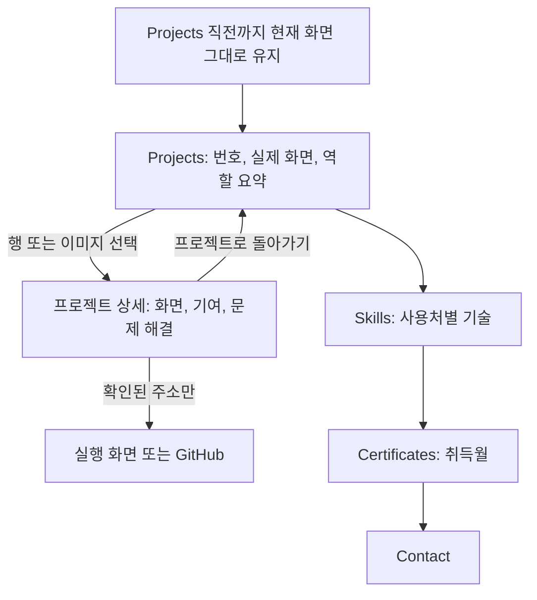

# 권현성 포트폴리오 개선 기획안

작성 기준: `이전 버전/2026-11-04_115812/html`의 `index.html`, `assets/editorial-home.css`, 세 프로젝트 상세 페이지. 2026-11-16 기준. 개발은 Ponytail full 기준을 따르고 기존 정적 HTML, CSS, 필요한 만큼의 JavaScript로 진행한다.

## 1. 이번 방향

현재 열어 둔 `이전 버전/2026-11-04_115812/html/index.html`을 기준으로 한다. **Projects 섹션 직전까지의 모든 화면과 내용은 그대로 둔다.** `Profile`과 경력 목록도 수정하지 않는다. 개선은 `Projects` 섹션부터 페이지 아래쪽의 프로젝트, Skills, 자격증, 연락처에만 적용한다.

앞서 만든 편집형 전면 재배치 시안은 이번 구현 기준이 아니다. 첫 화면을 좌우로 나누거나 프로젝트를 큰 잡지형 카드로 바꾸지 않는다.

| 현재 요소 | 유지 | 개선 |
| --- | --- | --- |
| Projects 위 전체 | 첫 화면, 대화형 소개, Profile, Experience의 디자인과 내용, 간격, 링크 | 변경하지 않음 |
| Projects | `01 / 02 / 03` 번호, 분류 배지, 제목, 설명, 행 전체 링크 | 각 행에 실제 화면 미리보기와 맡은 일 한 줄, 기술 일부 추가 |
| Skills | 회사 실무 / CityWatch / Common Tester 세 행 | 기술 줄바꿈과 강조색을 정리하고 각 사용처를 프로젝트와 연결 |
| Contact | 큰 제목과 이메일 | 자격증 섹션 뒤에 이어지는 여백 정리 |

Projects 아래의 색 적용은 기존 `#102849` 남색과 흰 배경을 기준으로 한다. 선명한 파란색은 `#365fd6` 부근의 강조색 한 가지로 제한하고, 옅은 파란색은 배지와 구분선에 사용한다. Projects 위는 손대지 않는다.

## 2. 방문 흐름

Projects 위의 기존 흐름을 유지한 채 방문자는 세 프로젝트의 차이를 파악하고, 관심 있는 프로젝트의 상세로 들어간다. 상세를 읽은 뒤 메인 `#work`로 돌아와 다음 프로젝트를 볼 수 있어야 한다. 기존 경력 행과 이동은 수정하지 않는다.

## 3. 프로젝트 목록의 구체적인 모습

기존 `.project-row`의 번호, 분류 배지, 제목, 설명, 화살표를 유지한다. 데스크톱에서는 설명 옆에 가로형 실제 화면 미리보기 한 장을 놓고, 모바일에서는 설명 아래로 내린다. 이미지가 제목보다 앞서 시선을 독점하지 않도록 크기를 제한한다. 세 행의 간격을 넉넉하게 두되 한 행 안의 정보는 짧게 둔다.

각 행에 표시할 정보는 다음 다섯 가지다.

1. 프로젝트 종류와 제목
2. 내가 맡은 일 한 문장
3. 해당 프로젝트의 실제 화면 한 장과 정확한 캡션
4. 핵심 기술 3~5개
5. 상세 이동을 알리는 화살표와 `자세히 보기` 문구

**행 전체가 기존 상세 페이지로 이동한다.** 이미지와 제목을 따로 눌러도 같은 곳으로 가는 구조가 된다. 하나의 행 안에 다른 링크를 중첩하지 않는다. `실행 화면`과 `GitHub`는 상세 페이지에서 별도의 링크로 제공한다. 새 팝업이나 접기 기능은 추가하지 않는다.

| 메인 행 | 내부 상세 경로 | 상세에서 먼저 보여줄 것 |
| --- | --- | --- |
| 공통 UI | `case-common-table.html` | 허용된 실제 업무 화면 또는 실제 Storybook 실행 화면, 테이블과 버튼의 담당 범위 |
| CityWatch FE Lab | `case-citywatch.html` | 실제 관제 화면, X-Ray에서 화면과 코드로 이어지는 흐름 |
| Common Tester | `case-common-tester.html` | 실제 실행 결과 화면, 근거에서 테스트 결과까지의 흐름 |

## 4. 실제 화면 캡처 계획

캡처는 서비스나 실행기를 열어 기능이 보이는 상태에서 제작한다. 디자인 이미지, 사례 페이지 자체, 재구성한 예시를 실제 서비스 사진이라고 부르지 않는다. 메인에는 프로젝트마다 대표 화면 한 장만 쓰고, 상세에는 설명에 필요한 장면만 추가한다.

| 프로젝트 | 지금 가진 자료 | 새 캡처 기준 | 확보 전 표시 |
| --- | --- | --- | --- |
| 공통 UI | 상세의 로그 조회, 장비 목록, Storybook은 재구성 예시. `common-table-desktop.jpg`는 사례 페이지 캡처 | 공개 가능한 실제 업무 화면에서 공통 테이블과 버튼이 함께 보이는 장면. 실제 Storybook만 가능하면 `Storybook 실행 화면`으로 명시 | 사진을 꾸며 넣지 않고 기존 텍스트 행 유지 |
| CityWatch FE Lab | `assets/citywatch-practice.png`는 실습 실행 화면 | [저장소 README](https://github.com/goodsosbva/citywatch-fe-lab)에 제시된 [공개 실행 주소](https://citywatch-web.vercel.app/?xray=all)에서 관제 화면과 X-Ray를 직접 확인한 뒤 새로 캡처 | 기존 사진을 쓸 경우 `실습 실행 화면`이라고 표기 |
| Common Tester | `assets/common-tester-results.png`는 실제 결과 보고서 | 실제 결과 보고서를 다시 캡처하고, 실행 UI가 있으면 작업 선택 화면도 상세에 추가 | 기존 사진을 `실행 결과 보고서`라고 표기 |

공통 UI는 회사 화면이므로 공개 가능한 캡처의 범위와 데이터 처리가 먼저 확정되어야 한다. 고객 정보, 내부 주소, 계정과 장비 식별 정보가 들어간 화면은 사용하지 않는다. Common Tester 결과 이미지에 적힌 외부 주소는 테스트 대상이므로 Common Tester 서비스 주소로 소개하지 않는다. 공개 실행 주소가 확인되지 않은 프로젝트에는 `Live` 버튼을 만들지 않는다.

캡처 파일은 프로젝트 이름으로 저장하고 원본 비율을 유지한다. 데스크톱 대표 화면을 먼저 고른 다음 모바일에서 이미지가 작아질 때 어떤 부분이 보이는지 확인한다. 상세의 각 이미지에는 화면 이름과 기능을 담은 대체 텍스트와 캡션을 붙인다.

## 5. 상세 페이지의 읽는 순서

기존 세 상세 페이지의 내용을 버리지 않고 첫 부분의 순서를 정리한다.

1. 프로젝트 제목, 한 문장 요약, 내가 맡은 범위
2. 실제 화면과 캡션
3. 해결하려던 문제와 기존 사용 흐름
4. 내가 구현하거나 개선한 부분
5. 화면에서 확인되는 결과와 코드 근거
6. `실행 화면` 또는 `GitHub`, `프로젝트로 돌아가기`

공통 UI는 실제 회사 화면을 확보하지 못하면 재구성 예시임을 계속 명시한다. CityWatch는 공개 실행 화면과 X-Ray 동작을 연결한다. Common Tester는 테스트 통과 수치와 정책 미확인을 구분해 적는다. 역할이나 성과를 확인 없이 확대하지 않는다.

## 6. 기술과 자격증

Skills는 현재의 **회사 실무 / CityWatch / Common Tester** 세 줄을 유지한다. 길게 이어진 슬래시 목록은 줄바꿈 가능한 짧은 기술명으로 정리한다. 관련 프로젝트명은 상세 페이지로 연결할 수 있으나 기술 로고 격자와 탭 UI는 추가하지 않는다.

Skills와 Contact 사이에 `Certificates.`를 기존 큰 영문 섹션 제목 방식으로 추가한다. 자격증은 이름과 취득월만 보이는 다섯 행이다.

| 자격증 | 취득월 |
| --- | --- |
| ADsP | 2026.11 |
| CKA | 2026.01 |
| SQL개발자(SQLD) | 2025.04 |
| 리눅스마스터 2급 | 2023.07 |
| 정보처리기사 | 2021.08 |

## 7. 참고 사이트에서 가져올 부분

- [Javier Tay](https://www.javiertay.dev/): 프로젝트 목록의 짧은 설명과 넓은 행 간격
- [Gabriel Cuétara](https://gcuetaraf.github.io/): 가는 선과 큰 여백으로 정보의 경계 표현
- [Tarik Karahodžić](https://www.tarikkarahodzic.dev/): 제목과 본문 사이의 크기 차이
- [Brittany Chiang](https://brittanychiang.com/): 남색 바탕에 어울리는 절제된 강조색과 경력 정보 위계
- [성태경](https://sungtaegyeong.dev/): 실제 프로젝트 화면에서 [상세 사례](https://sungtaegyeong.dev/projects/checktask)로 이동하는 연결
- [변세준](https://sejunb.com/): 실제 화면과 구현 근거를 이어서 보여주는 상세 구성

각 사례에서 **부분적인 표현 방식**만 참고한다. 현재 사이트의 중앙 사진 카드, 대화형 소개, 페이지 순서를 이 사이트들의 레이아웃으로 바꾸지 않는다.

## 8. 작업 순서와 완료 기준

| 순서 | 작업 | 확인할 결과 |
| --- | --- | --- |
| 1 | Projects 직전까지의 현재 화면을 기준 이미지로 기록 | Projects 위 전체가 변경되지 않았는지 비교할 수 있음 |
| 2 | Projects부터 아래쪽의 색과 행 간격 조정 | Projects 위는 그대로이고 아래 영역의 파란색 강조가 일관됨 |
| 3 | 공개 가능한 실제 화면 확보 | 이미지마다 출처와 캡션이 정해짐 |
| 4 | 프로젝트 행에 이미지와 역할, 기술 추가 | 기존 행 전체 링크로 정확한 상세 페이지에 이동함 |
| 5 | 세 상세 페이지의 대표 화면과 내용 순서 정리 | 메인에서 본 화면과 상세의 설명이 일치함 |
| 6 | Skills 정리와 Certificates 추가 | 사용처 분류와 ADsP 2026.11이 표시됨 |
| 7 | 데스크톱, 모바일, 키보드 탐색 확인 | 사진 카드, 프로젝트 이동, 상세 복귀, 이미지 크롭과 줄바꿈이 정상임 |

이번 문서는 **구현 기획안**이다. 구 프로젝트의 HTML과 CSS, 서비스 캡처는 아직 변경하지 않았다. 이미지 시안과 구현 범위는 Projects 섹션부터 페이지 끝까지다.

## Projects부터 페이지 끝까지의 이미지 시안

- [Projects부터 시작하는 시안](portfolio-profile-below/01-projects-from-projects.png)
- [기술, 자격증과 연락](portfolio-profile-below/02-skills-certificates-contact.png)

이미지의 공통 UI 화면 자리는 실제 업무 화면이 확보되기 전의 표시 위치다. CityWatch와 Common Tester의 화면은 구 프로젝트에 보관된 실행 이미지의 모습을 참조했다. 이 두 이미지는 완성 후의 **배치 시안**이며 웹사이트의 실제 캡처가 아니다. 첫 번째 시안은 Projects 제목부터 시작한다. Projects 위의 화면은 시안에 넣거나 변경 대상으로 삼지 않는다.
