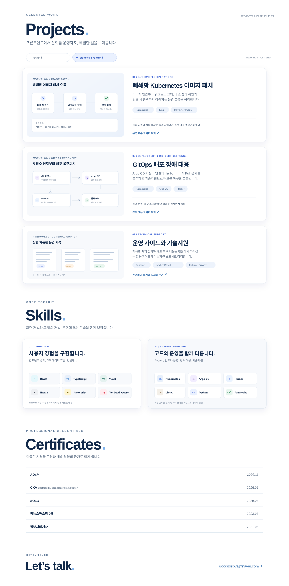

# 포트폴리오 확장 기획: Frontend와 Beyond Frontend

## 목표

기존 구프로젝트 포트폴리오의 첫 화면과 Profile은 유지하고, Projects부터 아래 영역에 프론트엔드 작업과 프론트엔드 외 엔지니어링 업무를 함께 보여준다. 현재 대표 프론트엔드 프로젝트 세 개는 그대로 두고, 쿠버네티스 운영, 배포 장애 대응, 기술지원과 운영 문서화 사례를 별도 보기로 추가한다.

## 추천 구성

### Projects 보기

Projects를 하나의 목록으로 두고 `Frontend`와 `Beyond Frontend` 보기만 둔다. Beyond Frontend는 프론트엔드 밖에서 수행한 백엔드, 자동화, 인프라, 배포, 기술지원 같은 작업을 담는 열린 이름이다. 현재 확인한 사례는 Kubernetes 운영, 배포 장애 대응, 운영 문서화이며 나중에 백엔드 사례가 추가돼도 분류명을 바꾸지 않는다. 전체 탭과 프로젝트 개수 표시는 두지 않는다.

Frontend 필터에는 기존 항목을 유지한다.

1. 공통 UI
2. CityWatch FE Lab
3. Common Tester

Beyond Frontend 보기에는 확인된 업무 기록을 바탕으로 사례를 추가한다.

1. **폐쇄망 Kubernetes 이미지 패치**: 이미지 아티팩트 반입, 워크로드 이미지 교체, 배포 상태 확인과 롤백 절차
2. **GitOps 배포 복구**: Argo CD 저장소 연결과 Harbor 이미지 Pull 오류를 살핀 장애 대응 흐름
3. **운영 문서와 기술지원**: 폐쇄망 패치 절차 안내와 배포 복구 내용을 실행 가이드 및 기술지원 보고서로 정리

공개 화면에는 고객사, 내부 주소, 클러스터명, 저장소 경로, 토큰과 운영 데이터는 싣지 않는다. 목록 카드의 그림은 흐름 요약으로 표시하고, 상세 사례에는 실제 운영 화면이나 명령 결과를 비식별 처리한 캡처를 사용한다. 본인 담당 범위와 결과는 업무 기록을 대조해 확인된 내용만 쓴다.

### Skills

회사나 프로젝트별로 자른 목록 대신, 직무에서 맡는 두 축을 한 화면에 둔다.

| 축 | 먼저 보일 기술 | 함께 보일 실무 역량 |
| --- | --- | --- |
| Frontend | React, TypeScript, JavaScript, Vue 3, Next.js, TanStack Query | 화면과 컴포넌트 설계, API 데이터 흐름, 접근성, 화면 품질 |
| Beyond Frontend | Python, Kubernetes, Linux, Argo CD, Harbor, 컨테이너 이미지 | 자동화, 인프라 운영 지원, 배포와 장애 대응, 기술지원, 실행 가이드 및 보고서 작성 |

각 기술 로고는 로컬 SVG 자산으로 둔다. 외부 CDN이 끊겨도 깨진 이미지가 나오지 않도록 텍스트 대체 표시를 함께 준비한다. 도구 이름을 많이 늘어놓기보다 실제 업무 흐름과 붙여 보여준다. Docker, Helm 등 사용이 확인되지 않은 도구는 임의로 추가하지 않는다.

### Certificates

자격증은 카드마다 색을 달리하지 않고 한 줄에 하나씩 이름과 취득 연월을 나란히 보여준다. CKA는 Beyond Frontend에 담긴 Kubernetes 업무와 연결해 읽을 수 있다.

| 자격증 | 취득 연월 |
| --- | --- |
| ADsP | 2026.11 |
| CKA, Certified Kubernetes Administrator | 2026.01 |
| SQLD | 2025.04 |
| 리눅스마스터 2급 | 2023.06 |
| 정보처리기사 | 2021.08 |

## 페이지 흐름

```text
기존 Hero와 Profile 유지
  ↓
Projects: Frontend 또는 Beyond Frontend 보기
  ↓
Beyond Frontend 사례 상세: 배경 → 담당 범위 → 조치 흐름 → 비식별 증거 화면 → 확인 결과
  ↓
Skills: Frontend와 Beyond Frontend 역량
  ↓
Certificates와 Contact
```

## 화면 원칙

- 기존 흰 배경, 남색 글자, 절제된 푸른색 포인트와 넓은 여백을 유지한다.
- 필터 버튼은 작고 단순하게 두며 현재 선택만 파란색으로 강조한다.
- Beyond Frontend 사례도 기존 프로젝트 행과 같은 카드 규칙을 사용한다.
- 프로젝트 목록 카드는 역할과 핵심 조치 한 줄을 보여주고, 자세한 순서와 캡처는 클릭한 상세에서 설명한다.
- 운영 성과 수치나 복구 시간처럼 기록으로 확인되지 않은 결과는 쓰지 않는다.
- 모바일에서는 프로젝트와 Skills를 한 열로 바꾸고, 필터는 가로로 넘치지 않게 줄바꿈한다.

## 기획 이미지

아래 이미지는 Projects의 Beyond Frontend 보기를 선택했을 때 보이는 현재 확인된 사례 세 개와 Skills, 자격증 배치를 보여준다. 이후 백엔드나 자동화 사례도 같은 보기 안에 추가할 수 있다. 실제 운영 화면 캡처가 아니며 업무 흐름을 설명하는 기획용 재구성이다.


