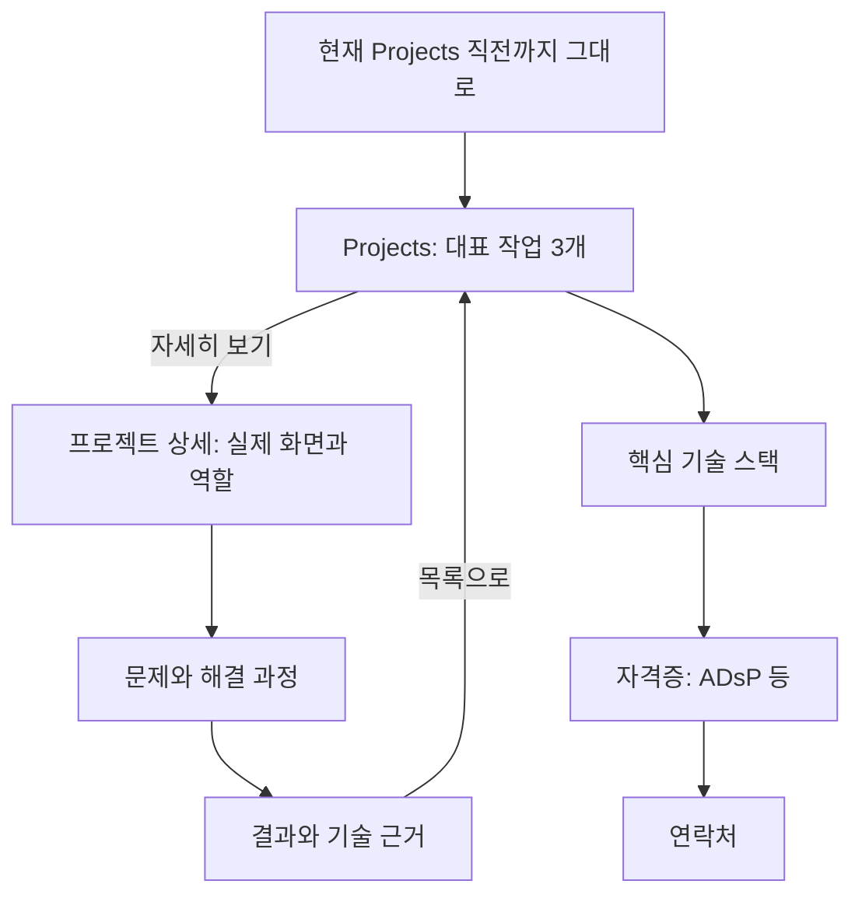
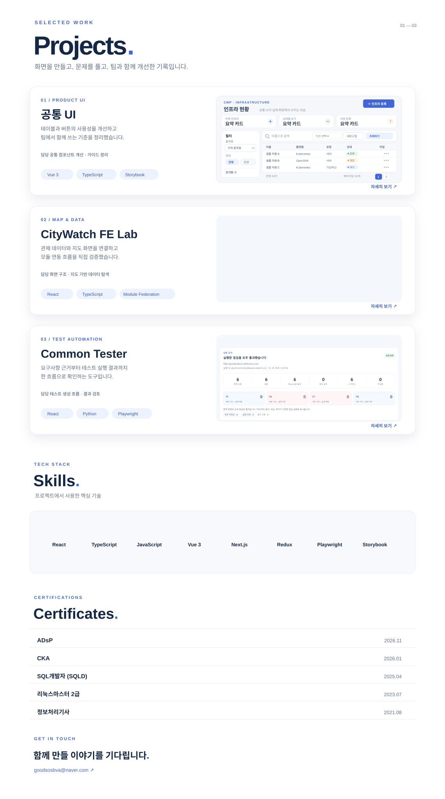

# 포트폴리오 개선안: Projects부터 다시 구성

## 기준

작업 기준은 `이전 버전/2026-11-04_115812/html/index.html`이다. **Projects 섹션 직전까지의 화면, 내용, 간격, 색, 동작은 고정한다.** Profile과 Experience는 그대로 둔다. 개선 범위는 Projects, Skills, Certificates, Contact와 프로젝트 상세 페이지다.

## 디자인 방향

배기영 포트폴리오에서 참고할 점은 프로젝트 카드가 제목, 한 줄 소개, 역할, 핵심 기술, 상세 이동을 한눈에 보여주고, 상세 화면이 실제 작업 이미지와 문제 해결 사례를 이어서 설명한다는 점이다. 이 정보 위계를 현재 사이트의 흰 배경, 남색 타이포, 절제된 파란 강조색에 맞춰 적용한다. 배기영 사이트의 전체 레이아웃이나 장식을 복사하지 않는다. [배기영 홈](https://portfolio-2026-tau-five.vercel.app/), [프로젝트 상세 예시](https://portfolio-2026-tau-five.vercel.app/projects/1)

디자인 원칙은 세 가지다.

1. 프로젝트 사이 여백을 넓혀 한 항목씩 편하게 읽는다.
2. 제목과 실제 서비스 화면을 크게 보여주고, 설명은 짧고 구체적으로 쓴다.
3. 파란색은 숫자, 링크, 작은 분류 표시 등 필요한 곳에만 쓴다.

## 메인 페이지 흐름

### Projects

현재 행 목록을 넓은 프로젝트 카드로 발전시킨다. 각 카드에 프로젝트 번호, 분류, 이름, 짧은 결과 중심 소개, 역할, 핵심 기술 3~4개, 실제 서비스 화면을 배치한다. 카드 전체를 클릭하게 하고 `자세히 보기 ↗`를 눈에 보이게 둔다. Demo와 GitHub 링크는 상세 화면에 모아 카드에서 링크가 서로 경쟁하지 않게 한다.

| 프로젝트 | 카드에서 먼저 보일 내용 | 상세로 이어질 핵심 |
| --- | --- | --- |
| 공통 UI | 테이블과 버튼의 공통 사용성 개선, Storybook 가이드 | 실제 공개 가능한 화면, 담당 범위, 공통화 전후 |
| CityWatch FE Lab | 지도 기반 관제 화면과 X-Ray 분석 | 화면 구조, 모듈 연동, 실제 실행 화면 |
| Common Tester | 테스트 요구 근거와 실행 결과 연결 | 생성 흐름, 실행 결과, 검증 범위와 한계 |

공통 UI 기여는 실제 CMP 인프라 현황 화면을 바탕으로 요약 카드, 필터, 검색과 기간 선택, 액션 버튼, 상태 배지, 데이터 테이블, 페이지 이동을 한 화면에 펼쳐 보여준다. 내부 인프라 값은 공개 이미지에 노출하지 않고 샘플 값으로 바꿔 재구성한다. CityWatch와 Common Tester는 프로젝트 폴더의 기존 실행 이미지를 사용한다.

### 핵심 기술 스택

기술을 회사별, 프로젝트별, 분야별 카드로 나누지 않는다. 참고 이미지의 탭 방식도 복사하지 않는다. **공식 브랜드 로고와 기술 이름을 같은 크기와 규칙으로 한 영역에 배열한 통합형 기술 갤러리**로 구성한다. React, TypeScript, JavaScript, Vue 3, Next.js, Redux, Playwright, Storybook을 보여준다. LangGraph와 RAG는 메인 Skills에서 제외하고 Common Tester 상세 설명에서만 맥락에 맞게 다룬다.

기술 이름의 크기와 배치로 우선순위를 표현하고 별점이나 퍼센트는 쓰지 않는다. 방문자는 첫눈에 주요 기술을 파악하고, 아래 프로젝트에서 실제 사용 맥락을 확인한다. Storybook, Ant Design Vue, pnpm, Nx, Module Federation은 각 프로젝트 상세에서 사용 근거와 함께 보여준다.

### 자격증과 연락처

Skills 다음에 Certificates를 배치한다. 자격증을 한 문장이나 태그 한 줄로 몰아 쓰지 않는다. 자격증 하나마다 독립된 행으로 이름과 취득월을 나란히 보여주고, 행 간 구분선을 둔다. ADsP는 `2026.11`로 표시한다. 이어서 기존 이메일 연락처를 둔다.

## 프로젝트 상세 페이지

지정된 상세 페이지에서 참고할 읽기 흐름은 제목과 역할을 먼저 보여준 뒤, 대표 화면, 개요와 성과, 사용 기술, 기능과 구조, 해결 과정 순으로 내려가는 방식이다. 이 흐름을 기존 정적 HTML 상세에 맞춰 단순하게 적용한다. [배기영 프로젝트 상세 예시](https://portfolio-2026-tau-five.vercel.app/projects/1)

1. 상단: `Projects` breadcrumb, 프로젝트 이름, 한 문장 설명, 기간과 역할
2. 첫 화면: 실제 서비스 캡처 한 장과 `실행 화면`, `GitHub`처럼 확인된 링크
3. 프로젝트 개요: 배경, 목표, 팀과 본인 담당 범위
4. 성과: 확인 가능한 결과를 짧은 문장으로 정리
5. 기술: 핵심 기술만 먼저 보여주고 선택 이유를 설명
6. 주요 구현: 기능과 화면 구조를 설명하는 실제 캡처
7. 문제 해결 사례: 문제, 선택지, 해결, 확인된 결과를 같은 순서로 반복
8. 하단: 이전/다음 프로젝트와 프로젝트 목록으로 돌아가기

상세 페이지는 긴 한 장의 설명문처럼 보이지 않도록 큰 섹션 간격, 짧은 문단, 실제 화면 캡션, 명확한 소제목을 쓴다. 내용을 꾸며내지 않고 코드와 실행 화면으로 확인되는 사실만 적는다.

## 구현 순서

| 순서 | 작업 | 확인 기준 |
| --- | --- | --- |
| 1 | Projects 직전 기준 화면을 보존하고 현재 아래 콘텐츠를 목록화 | 기준 구간에 수정 사항 없음 |
| 2 | 세 프로젝트의 소개, 역할, 대표 화면과 공개 링크 확인 | 카드 문구와 이미지에 근거가 있음 |
| 3 | Projects 카드 및 상세 페이지 정보 구조 적용 | 각 `자세히 보기`가 해당 프로젝트 상세로 이동 |
| 4 | 통합형 Skills와 Certificates 구성 | 회사나 분야별로 쪼개지 않고 핵심 기술과 자격증을 빠르게 식별 |
| 5 | 모바일과 키보드 이동 확인 | 카드 전체 링크, 캡처 비율, 줄바꿈 정상 |

## 최종 기획 이미지

아래 이미지는 Projects부터 페이지 끝까지의 최종 기획 화면이다. Projects 위 영역은 범위에 포함하지 않는다. CityWatch와 Common Tester는 기존 실행 캡처를 사용했다. 공통 UI 프리뷰는 실제 CMP 인프라 현황 화면의 구성 요소를 참고해 만들고, 내부 데이터를 샘플 값으로 비식별 처리했다.

