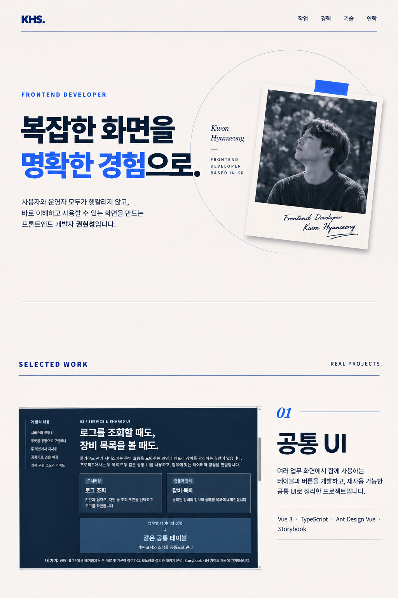

# 포트폴리오 디자인 재정비안

프로젝트 클릭 흐름과 실제 서비스 캡처 기준은 [새 기획안](../portfolio-reference-v5/project-flow-and-capture-plan.md)을 따른다. 이 문서는 시각 방향을 기록한 이전 버전이다.

2026-11-16 기준. 구 프로젝트 `legacy/html`의 흰색, 남색, 파란색과 프로필 사진을 출발점으로 삼는다.

## 살펴본 사례

| 사례 | 가져올 요소 | 이 사이트에 적용할 방식 |
| --- | --- | --- |
| [Tarik Karahodžić](https://www.tarikkarahodzic.dev/) | 화면을 장악하는 큰 첫 문장, 절제된 작업 목록 | 한국어 핵심 문장을 첫 화면의 주인공으로 쓴다 |
| [Gabriel Cuétara](https://gcuetaraf.github.io/) | 좌우 비대칭 구성, 얇은 선, 넓은 여백 | 프로필 사진과 본문을 비대칭으로 배치한다 |
| [Javier Tay](https://www.javiertay.dev/) | 지면 같은 리듬과 번호가 붙은 프로젝트 목록 | 프로젝트를 번호, 제목, 한 줄 설명으로 먼저 읽히게 한다 |
| [변세준](https://sejunb.com/) | 실제 화면, 역할, 구조, 문제 해결을 연결한 사례 설명 | 각 프로젝트에 실제 화면과 본인이 한 일을 넣는다 |

## 최종 방향

1. 첫 화면은 큰 한국어 문장, 기존 사진 카드, 얇은 원형 선으로 구성한다. 색은 기존 남색과 파란색을 유지하고 배경만 약한 미색으로 조정한다.
2. 프로젝트는 접히는 목록 대신 실제 화면을 크게 보여준다. 공통 UI를 대표 사례로 두고 CityWatch FE Lab과 Common Tester를 넉넉한 간격으로 한 줄씩 배치한다. 각 항목에는 역할, 사용 기술, 상세 사례 링크를 붙인다.
3. 기술은 로고 표를 없애고 `Interfaces`, `Quality`, `Tools & data` 세 줄에 배치한다. 프로젝트에서 실제 사용한 기술만 적는다.
4. 자격증은 화면 하단의 간결한 행으로 표시한다. ADsP 취득 시점은 `2026.11`로 표기한다.

## 시안에서 구현 전에 바로잡을 점

시안의 대표 프로젝트 이미지는 현재 저장된 `common-table-desktop.jpg`를 사용한 개념 표현이다. 이 파일은 공통 UI 사례 페이지를 캡처한 화면이다. 실제 사이트 작업 시에는 Storybook 테이블과 버튼의 실제 실행 화면을 캡처해서 대표 이미지로 교체한다. 프로젝트 기간과 상세 역할도 구 프로젝트의 원문을 확인해 확정한다.

## 여백 조정

첫 화면을 한 화면 높이로 확보하고, 대표 프로젝트가 시작되기 전 여백을 넓힌다. 대표 프로젝트 이미지의 높이를 늘리고, 나머지 두 프로젝트는 나란한 카드 대신 각각 독립된 줄로 배치한다. 기술과 자격증은 아래로 내려, 한 화면에 모든 내용을 밀어 넣지 않는다.

시안은 내장 이미지 생성 도구로 제작했다. 최종 프롬프트의 핵심은 기존 미색, 남색, 파란색과 사진 카드를 유지하면서 첫 화면을 한 화면 높이로 늘리고, 대표 프로젝트 앞에 충분한 여백을 두며, 하단 영역을 이 이미지에 억지로 넣지 않는 것이었다.
