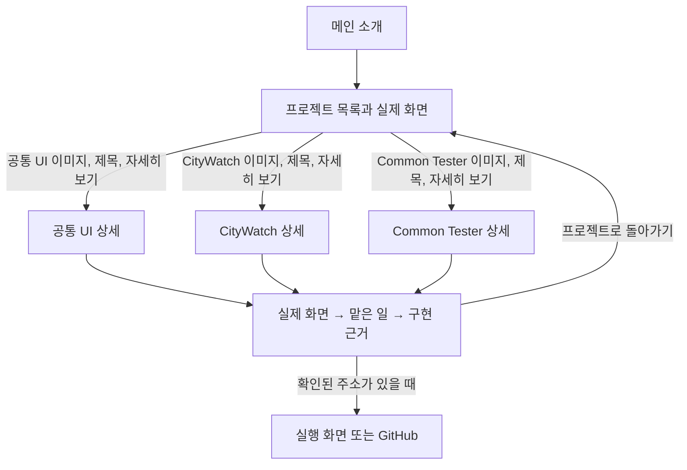

# 포트폴리오 프로젝트 이동과 실제 화면 캡처 계획

최신 방향은 [기본 디자인 유지형 개선 기획안](../2026-11-16-original-design-upgrade-plan.md)을 따른다. 이 문서는 이전의 프로젝트 중심 재배치안이다.

기준: `이전 버전/2026-11-04_115812/html`. 2026-11-16 확인. 현재의 넓은 편집형 시안은 시각 방향으로만 사용하고, 프로젝트 내용과 화면은 원본 파일 및 실행 중인 서비스에서 다시 확인한다.

## 방문자가 읽는 순서

1. 첫 화면에서 개발자 소개와 사진을 본다.
2. 아래로 내려 대표 프로젝트의 **실제 실행 화면**과 한 줄 요약을 본다.
3. 이미지, 제목 또는 `자세히 보기`를 누르면 해당 포트폴리오 상세 페이지로 이동한다.
4. 상세 페이지에서 실제 화면, 맡은 일, 문제와 해결, 구현 근거를 차례로 읽는다.
5. 상세 페이지에서 `실행 화면`, `GitHub`가 있을 때만 외부로 이동한다. `프로젝트로 돌아가기`는 메인의 해당 프로젝트 위치로 돌아온다.
6. 메인의 나머지 두 프로젝트, 기술 사용 맥락, 자격증, 연락처로 이어진다.

## 화면 구성

### 메인 프로젝트 영역

- 기존 남색과 파란색, 사진 카드를 유지한다. 소개와 프로젝트 사이의 넓은 여백도 유지한다.
- 공통 UI는 큰 이미지 한 장과 오른쪽 설명으로 시작한다. CityWatch와 Common Tester는 아래에서 각각 독립된 한 줄을 차지한다. 세 프로젝트를 한 화면에 압축하지 않는다.
- 각 프로젝트에 **실제 화면 1장, 종류, 제목, 내가 맡은 일 한 문장, 기술 3~5개, `자세히 보기`**를 표시한다.
- 이미지, 제목, `자세히 보기`는 모두 같은 내부 상세 페이지로 이동한다. 외부 실행 주소와 GitHub는 별도 링크로 구분한다.
- 이미지에는 보이는 기능을 설명하는 대체 텍스트를 쓴다. 클릭 영역에 키보드 초점과 눈에 띄는 포커스 표시를 제공한다.

### 상세 페이지 공통 순서

1. 제목과 짧은 결론, 프로젝트 종류와 맡은 범위
2. 실제 실행 화면을 크게 보여주는 대표 이미지와 정확한 캡션
3. 해결하려던 문제와 기존 흐름
4. 내가 구현한 부분과 화면에서 확인할 수 있는 결과
5. 필요할 때만 기술 선택 이유, 코드나 실행 과정, 한계
6. `실행 화면` 또는 `GitHub`, `프로젝트로 돌아가기`

한 프로젝트에 모든 기술을 억지로 나열하지 않는다. 메인에서는 먼저 결과를 보여주고, 상세에서 기술과 근거를 따라가게 한다. 메인과 상세는 같은 이름과 기술 표기를 사용한다.

## 프로젝트별 링크와 캡처

| 프로젝트 | 메인에서 누르면 | 대표 캡처 후보 | 현재 확인된 상태 | 상세의 핵심 내용 |
| --- | --- | --- | --- | --- |
| 공통 UI | `case-common-table.html` | 실제 업무 화면의 공통 테이블과 버튼 또는 실제 Storybook 실행 화면 | 현 상세의 로그 조회, 장비 목록, Storybook 화면은 **재구성 예시**로 명시됨. `common-table-desktop.jpg`도 사례 페이지 캡처임 | 사용한 화면, 테이블과 버튼의 담당 범위, 공통화와 가이드 |
| CityWatch FE Lab | `case-citywatch.html` | [공개 실행 주소](https://citywatch-web.vercel.app/?xray=all)의 관제 화면과 X-Ray 동작 | 저장소 README에 실행 주소가 있음. 기존 `assets/citywatch-practice.png`는 실습 실행 화면 캡처임. 새 캡처 전 접속과 동작 확인 필요 | X-Ray에서 실행 화면, 구현 위치, 코드로 이어지는 흐름 |
| Common Tester | `case-common-tester.html` | 실제 실행의 작업 선택 화면과 결과 보고서 | 기존 `assets/common-tester-results.png`는 실제 결과 화면 캡처. 공개된 독립 서비스 주소는 확인되지 않음 | 요구사항 근거 → 테스트 생성 → Playwright 실행 → 결과 확인 |

CityWatch 저장소의 실행 주소는 [README](https://github.com/goodsosbva/citywatch-fe-lab)에 나온다. Common Tester [공개 저장소](https://github.com/goodsosbva/common_tester)는 실행기와 문서를 안내하며, 현재 확인한 범위에서 별도의 공개 웹앱 주소를 제시하지 않는다. 기존 Common Tester 결과 캡처 안의 `goodsosbva1.dothome.co.kr`은 **테스트 대상 주소**이므로 Common Tester의 서비스 주소로 표시하지 않는다.

### 캡처 제작 규칙

1. 서비스나 실행기를 직접 열어 작동 상태를 확인한 뒤 캡처한다. 디자인 시안, 사례 페이지, 재구성 예시를 실제 서비스 화면이라고 표시하지 않는다.
2. 프로젝트마다 메인용 한 장을 먼저 고른다. 실제 기능이 보이는 순간을 선택하고, 브라우저 전체보다 필요한 화면을 넓게 잡는다. 이미지 비율은 공통으로 정하되 화면을 늘이거나 찌그러뜨리지 않는다.
3. 상세 페이지에는 필요할 때만 흐름을 보여주는 2~3장을 추가한다. 캡션에는 화면 이름과 사용자가 보는 기능을 적는다.
4. 회사 서비스 화면은 외부 공개가 가능한 상태인지 먼저 확인하고, 계정, 고객, 장비, 내부 URL 등 공개하면 안 되는 정보를 제거한 **허용된 캡처**만 사용한다. 확보 전에는 사진을 만들거나 예시를 실제 화면처럼 대체하지 않고 텍스트와 명확한 `구성 예시` 표기를 유지한다.
5. CityWatch는 공개 실행 화면에서 새로 캡처한다. 접속이 되지 않으면 기존 실습 캡처를 `실습 실행 화면`으로 정확히 표기하고, 공개 서비스 대표 화면이라고 부르지 않는다.
6. Common Tester는 실제 결과 보고서 캡처를 우선 사용한다. 작업 선택부터 결과까지 보여줄 수 있는 실행 UI가 확보되면 그 화면을 추가한다. 실행 UI가 없으면 결과 보고서를 정확히 그렇게 부른다.

## 구현 순서

| 순서 | 작업 | 완료 기준 |
| --- | --- | --- |
| 1 | 세 프로젝트의 캡처 원본과 공개 가능 범위 확인 | 이미지마다 출처, 화면 이름, 캡션이 정해짐 |
| 2 | 실제 화면 캡처와 크기 정리 | 메인용 3장과 필요한 상세용 이미지가 준비됨. 공통 UI는 허용된 원본 확보 전 보류 |
| 3 | 메인의 세 프로젝트 레이아웃과 링크 수정 | 이미지, 제목, 자세히 보기에서 동일한 상세로 이동함 |
| 4 | 기존 상세 페이지의 첫 화면과 내용 순서 정리 | 실제 화면이 먼저 보이고 담당 범위와 근거가 이어짐 |
| 5 | 실행 주소와 GitHub 링크 연결 | 외부 링크가 정확한 목적지로 가며 없는 링크는 표시하지 않음 |
| 6 | 데스크톱과 모바일, 키보드 확인 | 이미지 크롭, 줄바꿈, 링크 초점, 상세 복귀가 정상 동작함 |

## 기존 구현에서 바로잡을 부분

- 구 프로젝트의 메인 프로젝트 행은 이미 세 상세 페이지로 연결된다. 새 레이아웃에서도 이 경로를 유지한다.
- 이전 시안의 미리보기 HTML에서 임시 `#work` 링크를 구 프로젝트 상세 경로로 교체했다. 세 프로젝트의 이미지와 제목 영역에서 상세 페이지로 이동할 수 있다. 실제 메인에 적용할 때도 같은 내부 링크를 유지한다.
- 이전 이미지 시안의 첫 큰 이미지는 사례 페이지 캡처다. 메인에 넣을 실제 서비스 캡처가 아니다.
- ADsP `2026.11`을 포함한 자격증은 프로젝트와 상세 흐름 뒤에 간결한 행으로 배치한다.

이 문서는 기획안이다. 클릭 흐름을 확인할 수 있도록 미리보기 HTML의 링크만 수정했다. 실제 서비스 화면의 새 캡처와 구 프로젝트 코드는 아직 수정하지 않았다.
