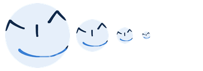

# 파비콘 시안 (2026-11-08)

대상: `이전 버전/2026-11-04_115812/html/index.html` — `<head>`에 파비콘 없음.

사이트 토큰에서 그대로 가져온 색: `--ink #102849`, `--accent #387ed4`, 마침표 강조 `#80b4ed`, 히어로 배경 `#e6effa`.

| 시안 | 파일 | 모티프 |
|---|---|---|
| **A (추천)** | [favicon-a.svg](favicon-a.svg) | 네이비 배경 + Georgia 이탤릭 K + 하늘색 마침표 (h1 `<em>권현성</em>` · `<span>.</span>`) |
| B | [favicon-b.svg](favicon-b.svg) | 헤더 `KHS` 브랜드의 위아래 선 + K |
| C | [favicon-c.svg](favicon-c.svg) | 원형, 히어로 배경색 + 네이비 K |

## 최종안: 스마일 (C안 스타일 + 손그림 스케치)



사용자 손그림의 **선 형태는 그대로**(원본 이미지에서 파란 획만 추출) 두고, 색만 사이트 CSS 토큰으로 교체. 연하늘 원형 배경 `#e6effa`, 눈·코 `#102849`(--ink), 입 `#387ed4`(--accent).
작은 크기(16·32px)는 획이 사라지지 않도록 굵기만 키움.

| 파일 | 용도 |
|---|---|
| [favicon-smile.ico](favicon-smile.ico) | 16/32/48 탭 아이콘 |
| [favicon-smile-32.png](favicon-smile-32.png) · [16](favicon-smile-16.png) | PNG 탭 아이콘 |
| [favicon-smile-180.png](favicon-smile-180.png) | iOS 홈 화면 (apple-touch-icon) |
| [favicon-smile-512.png](favicon-smile-512.png) | 원본 고해상도 |

```html
<link rel="icon" href="assets/favicon-smile.ico" sizes="any" />
<link rel="icon" href="assets/favicon-smile-32.png" type="image/png" sizes="32x32" />
<link rel="apple-touch-icon" href="assets/favicon-smile-180.png" />
```

### 적용 완료 (2026-11-08)

- 대상: `이전 버전/2026-11-04_115812/html/` 최상위 페이지 9개 (index, career-*, case-*)
- `assets/`에 `favicon-smile.ico`, `favicon-smile-32.png`, `favicon-smile-180.png` 복사
- 각 페이지 `</title>` 바로 뒤에 위 `<link>` 3줄 삽입
- 루트 `html/`(현재 git 버전)과 `nextjs-portfolio/`에는 미적용

## 적용 방법 (A~C안)

선택한 SVG를 `html/assets/favicon.svg`로 복사 후 `<head>`에 한 줄:

```html
<link rel="icon" href="assets/favicon.svg" type="image/svg+xml" />
```

- SVG 파비콘은 최신 Chrome/Edge/Firefox/Safari 지원. 구형 IE용 `.ico`는 생략.
- 글자는 시스템 Georgia 폰트로 렌더링 (Windows/macOS 기본 탑재).
